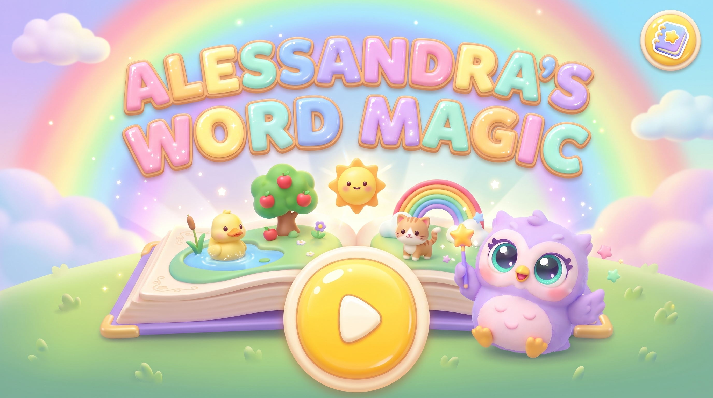
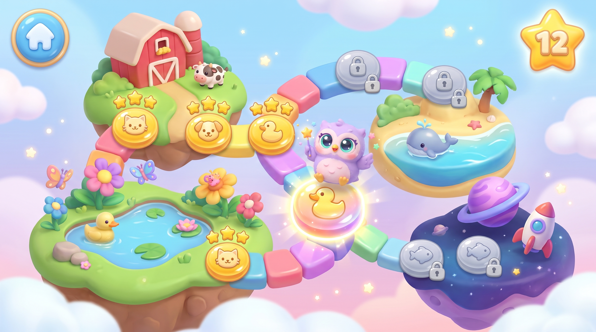
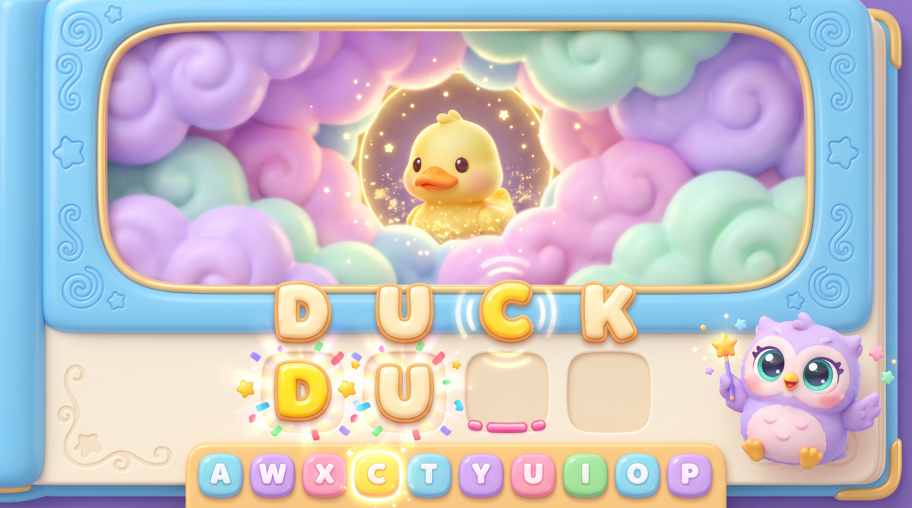
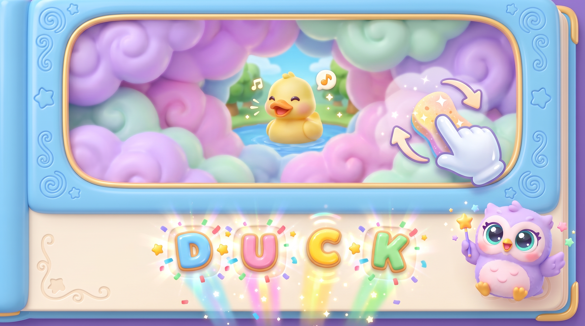
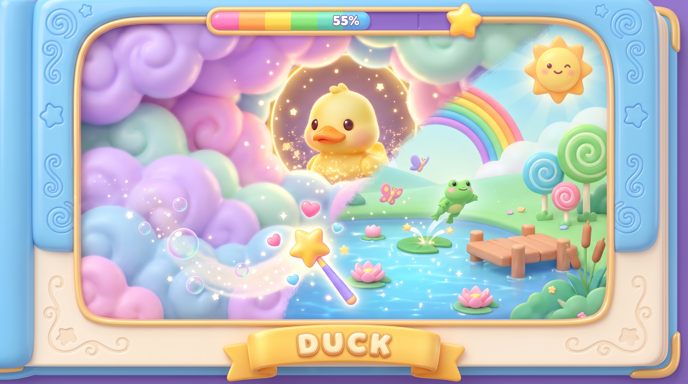
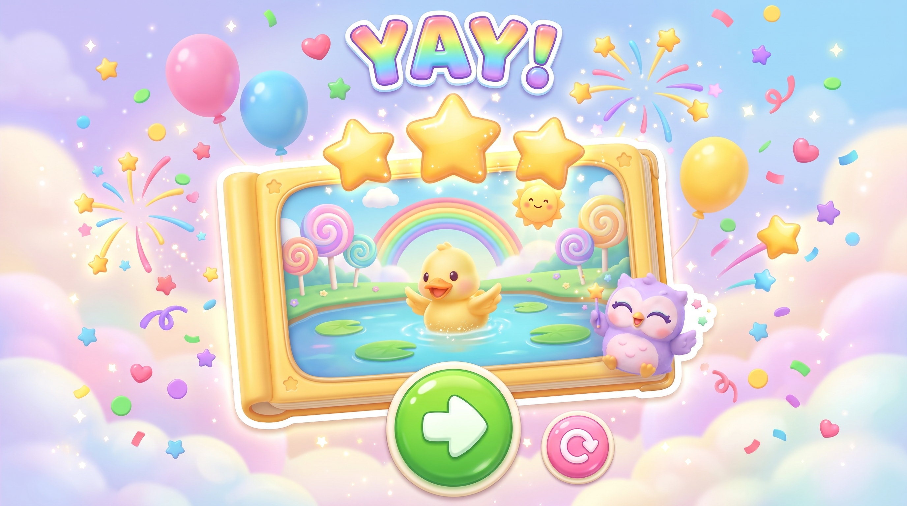
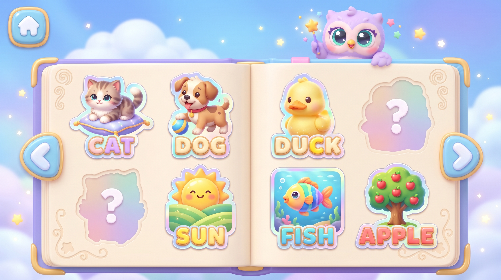
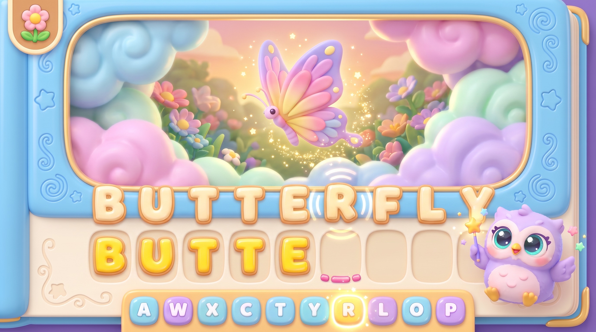
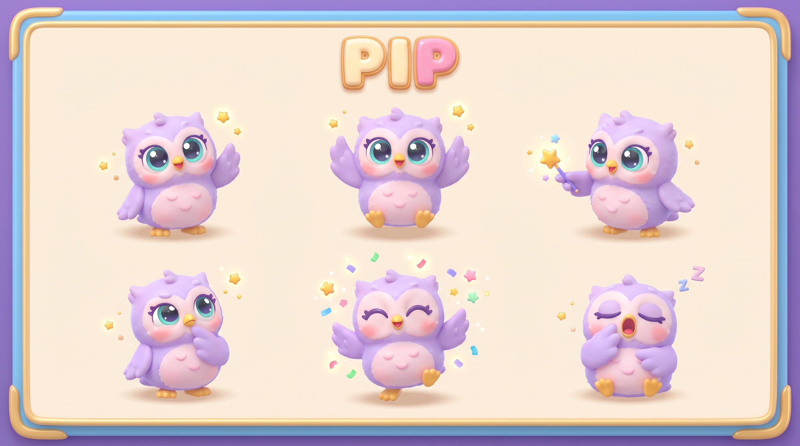
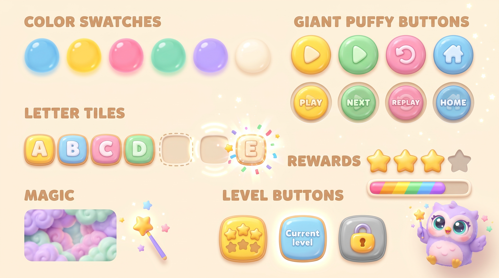

# Alessandra's Word Magic — Game Design Plan

A typing-and-discovery game for ages 3–5. The child types a word, the word's picture magically appears, then she wipes away magic clouds with the mouse to uncover the whole scene.

The screen designs are in [`screens/`](screens/). They were generated with Gemini (`gemini-3-pro-image`). To regenerate them, run `python plan/tools/screens.py [screen_name ...]`, which reads the key from `.env`. `03_typing` is the style reference: every other screen is generated with it attached so that Pip and the UI stay consistent.

---

## 1. Core loop

```
Map → pick level → TYPE the word → picture subject appears → UNCOVER the scene with the mouse → celebration + sticker → Map
```

1. **Type.** The word appears as big letter tiles with one empty slot per letter. Each correct key fills the next slot with a pop animation. At the same time, the magic clouds over the picture's centre open a little more and the subject, such as the duck, appears piece by piece.
2. **Word complete.** The letters do a happy wave and the subject animates (the duck quacks). A giant hand-and-sponge hint then shows her to rub the clouds.
3. **Uncover.** Moving the mouse over the clouds wipes them away. The cursor is a magic wand that trails glitter. Hidden surprises (a frog, a butterfly) pop and play a sound when they're uncovered. A rainbow bar fills up as she goes.
4. **Celebrate.** Once about 85% of the picture is uncovered, the rest melts away automatically. She gets 3 stars, confetti and a "YAY!", and the picture goes into her sticker book.

**There's no way to fail.** A wrong key makes the next tile wobble and plays a soft "boop". It never deletes anything or counts as an error. Stars reward finishing, not accuracy.

## 2. Screens

| # | Screen | Design | Purpose |
|---|--------|--------|---------|
| 1 | Title |  | Giant PLAY button and Pip waving. Sticker book button top right. |
| 2 | World map |  | Islands: Farm → Pond → Garden → Ocean → Space. Coin-shaped level buttons along a candy path. |
| 3 | Typing |  | **Main screen.** Letter tiles, slots, next key glowing on the keyboard strip, subject appearing. |
| 4 | Word complete |  | Letter wave, subject fully visible, rub-the-clouds hint. |
| 5 | Uncover |  | Mouse wipes clouds away, surprises pop, progress bar fills. |
| 6 | Level complete |  | Stars, confetti, NEXT and REPLAY buttons. |
| 7 | Sticker book |  | Collection of every finished picture with its word. |
| 8 | Harder level |  | Long word (BUTTERFLY) with smaller tiles and the same layout. |
| 9 | Pip, the mascot |  | Poses: wave, cheer, point, think, dance, sleep. |
| 10 | UI kit |  | Colours, buttons, tiles, stars, progress bar, clouds, level buttons. |

## 3. Level progression

Words get longer and letter patterns get harder. Early words use letters that are easy to find on the keyboard.

| World | Stage | Words | Typing help |
|-------|-------|-------|-------------|
| 🐄 Farm | 3 letters, simple | CAT, DOG, COW, PIG, HEN, SUN | Next key glows on the keyboard strip, and Pip points at it |
| 🦆 Pond | 3–4 letters | DUCK, FISH, FROG, BOAT, BEE | Next key glows |
| 🌸 Garden | 4–5 letters | TREE, APPLE, BIRD, FLOWER, SNAIL | Next key glows after 3 seconds of hesitation |
| 🐳 Ocean | 5–6 letters | WHALE, CRAB, SHELL, TURTLE, OCTOPUS | Glow only after a wrong key |
| 🚀 Space | 6–9 letters | ROCKET, PLANET, RAINBOW, BUTTERFLY, DINOSAUR | Glow only when she asks (Pip button) |

Each world has 5 or 6 levels, and a world unlocks when the previous one is finished. There should also be a parent-only way to jump to any level (see §6).

## 4. Look and feel

- **Style.** Soft clay-like 3D in the style of an animated film: chunky, rounded, glossy. Everything looks squeezable.
- **Palette.** Sky blue `#7EC8F2`, sunshine yellow `#FFD34E`, bubblegum pink `#FF8FB1`, mint `#7FDBB6`, lavender `#B79CFF`, cream `#FFF6E5`.
- **Font.** Extra-bold, rounded, uppercase letters. "Fredoka" or "Baloo 2" from Google Fonts both work. Uppercase only, because keyboards are labelled in uppercase.
- **Pip the owl.** Guide and cheerleader. Reacts to everything: cheers on each correct letter, looks thoughtful after a wrong key, dances when a level is done, and falls asleep if she's idle for too long.

## 5. Animations and effects

| Moment | Animation |
|--------|-----------|
| Correct letter | The slot squashes and stretches as the letter drops in. A star burst and confetti pop out. The picture's cloud hole grows and more of the subject appears (dissolve shader). The letter is spoken aloud ("D!"). |
| Wrong key | The target tile wobbles gently and Pip tilts its head. Nothing is removed. |
| Word complete | The letters do a Mexican wave, a rainbow shimmer sweeps across them, and the whole word is spoken ("DUCK!"). The subject plays its idle animation and sound. |
| Uncover | A cloud shader with a painted erase mask follows the mouse. The wand trails glitter, bubbles and hearts. Surprises pop in with a spring animation. |
| Level complete | Stars drop in one by one with a chime, then confetti and fireworks. The picture flies into the sticker book. |
| Idle | Clouds drift slowly, sparkles float, and Pip blinks. |

## 6. Technical plan (Three.js)

- **Stack.** Vite, Three.js and TypeScript. It's a single-page app that runs in any browser. Full-screen 16:9 with letterboxing.
- **Rendering.**
  - UI elements (letter tiles, buttons, stars, Pip) are 3D meshes: rounded boxes (`RoundedBoxGeometry`) with `MeshPhysicalMaterial` using clearcoat for the jelly look, soft area lights and an environment map.
  - The picture is a flat illustration (PNG) on a plane inside the 3D storybook frame, as the brief asked.
  - The clouds are a separate plane using a custom shader: fbm noise clouds in pastel colours, whose alpha comes from a **reveal mask** render target.
  - The subject appears through a radial reveal in the same mask, which grows with typing progress.
  - The mouse paints soft circles into the mask with a brush. The share of cleared pixels is sampled from a small downscaled copy and drives the progress bar.
  - Particles (sparkles, confetti, glitter trail) are instanced sprites.
  - Post-processing: bloom for the glow, plus a slight vignette.
- **Animation.** GSAP for tweens (squash and stretch, waves, spring pops).
- **Audio.** Howler.js. Spoken letters and words, generated with TTS. Pops, chimes, and one sound per animal.
- **Pictures.** Each level has a scene illustration with the subject in the centre, plus 1–3 "surprise" hotspot positions. These can be generated with the same Gemini pipeline in the same style.
- **Save.** Stars and stickers are saved in `localStorage`.
- **Parent corner.** Hold the **P** key for 3 seconds to open settings: level select, sound volume, and hint level.
- **Kid-proofing.** Ignore modifier keys, block browser shortcuts where possible (Backspace navigation, Ctrl+W can't be blocked), make the cursor large, and never show a dead end.

## 7. Build order

1. Project scaffold, scene, storybook frame, camera and lights.
2. Letter tiles, slots and keyboard input, with the typing flow working on DUCK.
3. Cloud shader, reveal mask, subject reveal while typing, and the mouse erase brush.
4. Celebrations, particles, Pip (start with a 2D sprite and swap in 3D later), and sound.
5. Map, level data, sticker book, and saving progress.
6. Generate the scene illustrations for every level, then polish.
